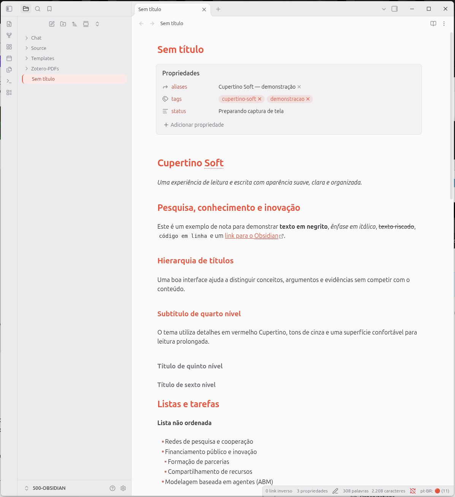
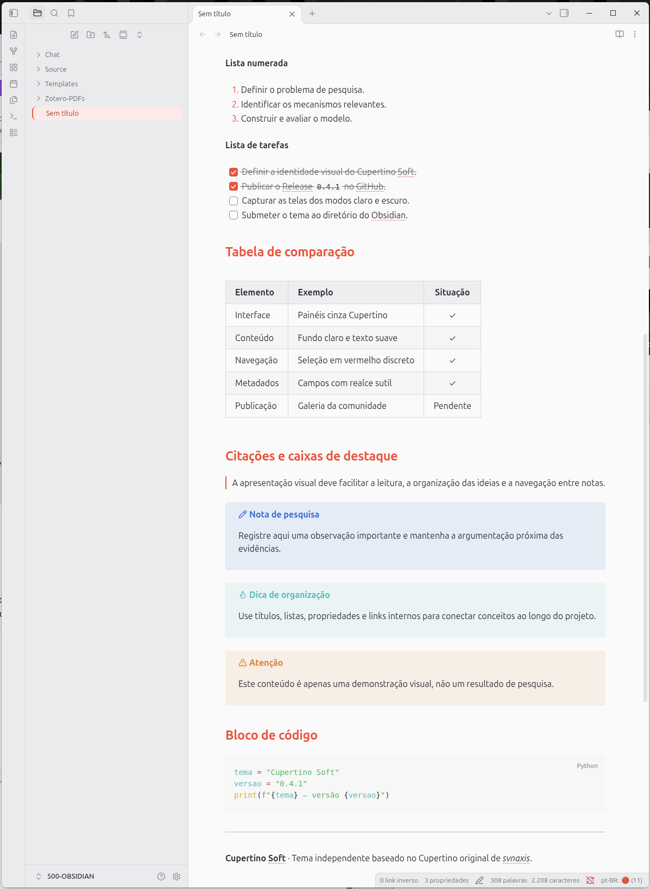

# Cupertino Soft

An independent, lightweight **light-and-dark theme for Obsidian**. Cupertino Soft brings a near-white reading surface, gentle gray navigation, discreet red accents, and a native-feeling interface without replacing Obsidian's window controls or layouts.

[](https://github.com/vict0rg/cupertino-soft/releases) · [Installation on Linux](INSTALL_LINUX.md) · [Release notes](RELEASE_NOTES.md)

**Companion project:** [Cupertino Zotero Soft Theme](https://github.com/vict0rg/cupertino-zotero-soft-theme) has a matching reading palette in Zotero.

## Screenshots / Capturas de tela

Real screenshots of **Cupertino Soft in light mode**, running in Obsidian on Linux:

| Typography, properties and lists | Tasks, tables, callouts and code |
| --- | --- |
|  |  |

A dark-mode screenshot and additional Linux visual checks are still pending.

## Features

- Original, appearance-only CSS; Obsidian keeps its own tabs, title bar, ribbon, and navigation.
- Soft **#FAFAFA** note background, **#EBEBED** side panels, and readable **#333338** text.
- Restrained **#FF3B30** red for headings H1–H4, links, syntax, and selected navigation entries.
- Gentle metadata panel, striped tables, Markdown lists, callouts, and code highlighting.
- Dark-mode color variables with the same restrained visual language.
- Orange **#FF9500** wavy misspelling marks, when Obsidian/Electron's spellchecker supports them.

The theme changes appearance only; it does not alter your notes or plugin settings.

## Installation

### Inside Obsidian

Once the theme is accepted into the Community directory, open **Settings → Appearance → Themes → Manage** and search for **Cupertino Soft**.

### Manual installation (works now)

Download [theme.css](https://github.com/vict0rg/cupertino-soft/raw/main/theme.css) and [manifest.json](https://github.com/vict0rg/cupertino-soft/raw/main/manifest.json). Save both inside:

```text
<your-vault>/.obsidian/themes/Cupertino Soft/
```

Restart Obsidian and select **Cupertino Soft** under **Settings → Appearance → Themes**.

### Linux: Flatpak or .deb

For a vault at `~/Dropbox/500-OBSIDIAN` (default), **close Obsidian** and run:

```bash
mkdir -p "$HOME/Downloads"
curl -fL --retry 3 \
  https://raw.githubusercontent.com/vict0rg/cupertino-soft/main/scripts/install-and-activate.sh \
  -o "$HOME/Downloads/instalar-cupertino-soft.sh"
bash "$HOME/Downloads/instalar-cupertino-soft.sh"
```

The installer downloads this project's two theme files and creates a dated backup of `.obsidian/appearance.json` before changing only `cssTheme`. Notes, plugins, snippets, and Dropbox files are preserved. To revert:

```bash
bash "$HOME/Downloads/instalar-cupertino-soft.sh" --reset
```

See [INSTALL_LINUX.md](INSTALL_LINUX.md) for full instructions, including a custom vault path and update options.

## Palette

| Element | Color |
| --- | --- |
| Writing surface | `#FAFAFA` |
| Navigation panels | `#EBEBED` |
| Metadata panel | `#F2F2F4` |
| Reading text | `#333338` |
| Accent | `#FF3B30` |
| Selection fill | `#FFE9E8` |
| Misspelling underline | `#FF9500` |

## Originality, inspiration and license

This is a **new independent repository**, not a GitHub fork. Its current `theme.css`, scripts, documentation and screenshots are authored for Cupertino Soft. It contains no source files, fonts, or graphical assets copied from the original [Cupertino for Obsidian](https://github.com/svnaxis/obsidian-cupertino) by **svnaxis**. The name and general visual direction acknowledge Cupertino's design influence; this does not imply an endorsement or affiliation.

An earlier experimental **GitHub fork** is retained separately at [vict0rg/cupertino-obsidian-soft-theme](https://github.com/vict0rg/cupertino-obsidian-soft-theme) for historical reference; its commit history is **not** included here. See [CREDITS.md](CREDITS.md) and [NOTICE.md](NOTICE.md) for attribution.

Cupertino Soft is licensed under [MIT](LICENSE). Maintained by [vict0rg](https://github.com/vict0rg). It is not affiliated with Obsidian or any upstream theme author.

## Community directory

The [0.4.1 release](https://github.com/vict0rg/cupertino-soft/releases/tag/0.4.1) provides `theme.css` and `manifest.json` for manual installation and the official directory submission. Listing inside Obsidian requires review and approval; track status in [SUBMISSION.md](SUBMISSION.md).
